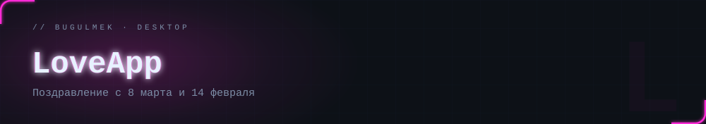

<!-- neon:header:start -->
<p align="center">
  
</p>
<!-- neon:header:end -->

<p align="center">
  
  
  
  
  
</p>

Поздравь свою девушку с 8 марта или 14 февраля — маленькое настольное
приложение, которое говорит больше, чем открытка.

## Запуск

```bash
./mvnw javafx:run
```

## Сборка

```bash
./mvnw clean package
```

Готовый артефакт появится в `target/`.

## Стек

| Слой | Технологии |
| --- | --- |
| Язык | Java |
| Интерфейс | JavaFX (FXML) |
| Сборка | Maven Wrapper |
| Платформа | Windows / macOS / Linux |

## Лицензия

© 2026 Bugulmek. Все права защищены.

Личное некоммерческое использование. Копирование, распространение и
коммерческое использование кода без письменного разрешения автора запрещены —
условия в [LICENSE](LICENSE).

<!-- neon:footer:start -->
<p align="center">
  
</p>
<!-- neon:footer:end -->
